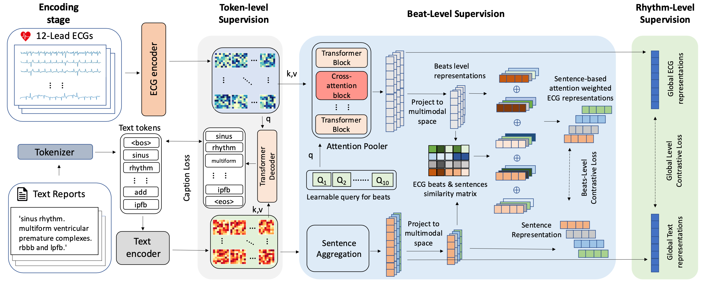

# MELP

<b>From Token to Rhythm: A Multi-Scale Approach for ECG-Language Pretraining</b>, ICML 2025.
<br><em>Fuying Wang, Jiacheng Xu, and Lequan Yu</em></br>

[Arxiv](https://arxiv.org/abs/2506.21803) | [Cite](#acknowledgements) | [HuggingFace](https://huggingface.co/fuyingw/MELP_Encoder)

**Abstract**: Electrocardiograms (ECGs) play a vital role in monitoring cardiac health and diagnosing heart diseases. However, traditional deep learning approaches for ECG analysis rely heavily on large-scale manual annotations, which are both time-consuming and resource-intensive to obtain. To overcome this limitation, self-supervised learning (SSL) has emerged as a promising alternative, enabling the extraction of robust ECG representations that can be efficiently transferred to various downstream tasks. While previous studies have explored SSL for ECG pretraining and multi-modal ECG-language alignment, they often fail to capture the multi-scale nature of ECG signals. As a result, these methods struggle to learn generalized representations due to their inability to model the hierarchical structure of ECG data. To address this gap, we introduce MELP, a novel Multi-scale ECG-Language Pretraining (MELP) model that fully leverages hierarchical supervision from ECG-text pairs. MELP first pretrains a cardiology-specific language model to enhance its understanding of clinical text. It then applies three levels of cross-modal supervision—at the token, beat, and rhythm levels—to align ECG signals with textual reports, capturing structured information across different time scales. We evaluate MELP on three public ECG datasets across multiple tasks, including zero-shot ECG classification, linear probing, and transfer learning. Experimental results demonstrate that MELP outperforms existing SSL methods, underscoring its effectiveness and adaptability across diverse clinical applications.



## Updates
- 23/10/2026: Zero-shot weights (ECG and text towers) from a reproduction run are on Hugging Face: [xjc1022/MELP-repro](https://huggingface.co/xjc1022/MELP-repro). See [Pretrained weights](#pretrained-weights).
- 29/05/2025: The first version of MELP code base is now alive.

## Installation 

```
conda create -n melp python=3.10
conda activate melp
pip install -r requirements.txt
pip install -e .
```

## Pretrained weights

| Hugging Face repo | contains | use for |
|---|---|---|
| [fuyingw/MELP_Encoder](https://huggingface.co/fuyingw/MELP_Encoder) | ECG tower | feature extraction, linear probing |
| [xjc1022/MELP-Encoder-repro](https://huggingface.co/xjc1022/MELP-Encoder-repro) | ECG tower, reproduction run | feature extraction, linear probing |
| [xjc1022/MELP-repro](https://huggingface.co/xjc1022/MELP-repro) | ECG and text towers, same reproduction run | zero-shot classification |

The encoder repos hold the ECG tower only, so they cannot score an ECG against a class
description by themselves. `xjc1022/MELP-repro` adds the text tower and its projection.
It was retrained with this code base (text tower `fuyingw/heart_bert`, raw wfdb waveforms,
lr 1e-4 with a 2-epoch warmup; full settings on the model card) and is not the checkpoint
behind the paper's tables. Zero-shot AUROC on the test splits:

| | PTB-XL Rhythm | PTB-XL Form | PTB-XL Sub | PTB-XL Super | CPSC2018 | CSN | Average |
|---|---|---|---|---|---|---|---|
| xjc1022/MELP-repro | 86.43 | 70.32 | 77.65 | 77.21 | 84.19 | 74.59 | 78.40 |
| Paper (Table 3) | 85.4 | 69.1 | 81.2 | 76.2 | 84.2 | 77.6 | 79.0 |

```python
import json, torch
from huggingface_hub import hf_hub_download
from transformers import AutoModel, AutoTokenizer

repo = "xjc1022/MELP-repro"
model = AutoModel.from_pretrained(repo, trust_remote_code=True).eval()
tokenizer = AutoTokenizer.from_pretrained(repo, trust_remote_code=True)

prompts = json.load(open(hf_hub_download(repo, "prompts/CKEPE_prompt.json")))
weights = model.zeroshot_weights(tokenizer, [prompts[c] for c in ["SR", "AFIB", "STACH"]])

ecg = torch.rand(2, 12, 5000)  # 12 leads (I, II, III, aVR, aVF, aVL, V1-V6), 500 Hz, min-max scaled to [0, 1]
with torch.no_grad():
    scores = model.encode_ecg(ecg) @ weights  # (2, 3) cosine similarities
```

The model card has the input format and the text tokenisation details. To export a
checkpoint you trained yourself in the same format:

```
cd scripts/hf
python export_melp.py CKPT_PATH OUT_DIR           # Lightning checkpoint -> HF folder
python test_equivalence.py CKPT_PATH OUT_DIR      # the export reproduces the checkpoint's embeddings
python eval_zeroshot_hf.py OUT_DIR                # six-dataset zero-shot from the HF folder alone
```

## Dataset Preparation

Every filesystem root resolves from the environment (see `src/melp/paths.py`; run
`python src/melp/paths.py` to print what currently resolves and whether it exists).

```
MELP_RAW_DATA_PATH            # raw datasets, one directory per dataset
|- mimic-iv-ecg
|- ptbxl
|- icbeb
|- chapman

MELP_PROCESSED_DATA_PATH      # output of scripts/preprocess/*; defaults next to the raw root
MELP_SPLIT_DIR                # data splits; defaults to the ones shipped under src/melp/data_split
MELP_ECGFM_PATH               # ECG-FM checkpoint used to initialise the ECG encoder (optional)
```

The MIMIC-IV-ECG splits are not shipped in this repo — download them (link below) and either
drop them at `src/melp/data_split/mimic-iv-ecg/` or point `MELP_SPLIT_DIR` at where they live.
ECG: 
- [MIMIC-IV](https://physionet.org/content/mimic-iv-ecg/1.0/)
- [PTB-XL](https://physionet.org/content/ptb-xl/1.0.3/)
- [Code-15%](https://zenodo.org/records/4916206)
- [CPSC 2018](https://physionet.org/content/challenge-2020/1.0.2/training/cpsc_2018/)
- [CSN](https://physionet.org/content/ecg-arrhythmia/1.0.0/)
- [G12E](https://physionet.org/content/challenge-2020/1.0.2/training/georgia/)

**Please download the splits of MIMIC-IV-ECG from [this link](https://drive.google.com/drive/folders/1RsLRFGoDwakC8smhUmVoBSkjq46To7vI?usp=sharing)**

## Walkthrough of MELP

## Pretraining Stage

```
cd scripts/pretrain
CUDA_VISIBLE_DEVICES=0,1,2,3 python main_pretrain.py \
    --run_name my_run --num_devices 4 --train_data_pct 1 \
    --model_name melp --ecg_encoder_name ecgfm --ecg_source raw \
    --ecg_encoder_weight "$MELP_ECGFM_PATH" \
    --text_encoder_name fuyingw/heart_bert \
    --lr 1e-4 --batch_size 64 --max_epochs 100 --warmup_epochs 2 \
    --n_queries_contrast 12 --val_check_interval 0.25 \
    --early_stopping_patience 12 \
    --clip_loss_weight 1.0 --caption_loss_weight 2.0 --local_loss_weight 0.2
```

Four of those flags are worth understanding before you change them.

**`--ecg_source`** selects where the pretraining waveforms come from: `raw` reads the wfdb
records under `MELP_RAW_DATA_PATH/mimic-iv-ecg/`, `processed` reads the denoised `.npy`
store written by `scripts/preprocess/preprocess_mimic_iv_ecg.py`. The two are not
interchangeable. The downstream datasets are always read raw, so pretraining on the
denoised store trains and evaluates on different distributions; on one config that cost
5.6 AUROC points on the six-dataset zero-shot average (70.75 vs 78.40). The denoising
moves the waveform enough to matter: whole-record correlation 0.855, lowest in V2-V4 at
0.75, which is where the form and sub-class tasks read.

**`--warmup_epochs`** must be non-zero with `fuyingw/heart_bert`. The learning-rate
schedule ramps in over this many epochs; without a ramp both towers collapse within ~25
steps, the contrastive loss sits at `ln(batch)` forever, and every zero-shot AUROC comes
out at exactly 0.5.

**`--val_check_interval`** controls how often validation runs, as a fraction of an epoch.
Validating only at epoch boundaries hides the peak: on one run the best checkpoint scored
0.7575 at step 1454 against 0.7138 at the boundary. Peaks are also late -- the best run so
far peaked at epoch 4, so `--early_stopping_patience` needs enough room to get there.

**`--run_name`** gives a run a stable directory name. Without it the name is a
second-resolution timestamp computed separately in each DDP rank, and two runs started in
the same second will overwrite each other's logs.

Reference: the command above is the run behind
[xjc1022/MELP-repro](https://huggingface.co/xjc1022/MELP-repro) (ECG and text towers, for
zero-shot) and [xjc1022/MELP-Encoder-repro](https://huggingface.co/xjc1022/MELP-Encoder-repro)
(ECG tower only). It reaches a six-dataset zero-shot average of 78.40 on the test splits
(paper reports 79.0).

`fuyingw/heart_bert` is `ncbi/MedCPT-Query-Encoder` after further training on cardiology
text (paper Appendix A.2; `scripts/pretrain_lm/pretrain_text_lm.py` reruns that stage).
`--ecg_encoder_weight` is the ECG-FM (wav2vec2-CMSC) checkpoint that initialises the ECG
tower; without it the tower starts from random weights. The run above started from the
authors' `epoch=44-step=131040.ckpt`, which is not published.

## Smoke test

```
python scripts/smoke_test.py      # datasets, model forward/loss/backward, zero-shot, linear probe, pretraining
```

## Evaluation 

### Linear Probing

```
cd scripts/finetune
CUDA_VISIBLE_DEVICES=0 python main_finetune.py \
    --model_name melp --dataset_name icbeb \
    --train_data_pct 0.01 \
    --ckpt_path CKPT_PATH \
    --num_devices 1
```

### Zero-shot Classification
```
cd scripts/zeroshot
python test_zeroshot.py --model_name melp --ckpt_path CKPT_PATH    # a Lightning checkpoint
python ../hf/eval_zeroshot_hf.py xjc1022/MELP-repro                 # the released weights
```

## Acknowledgements
If you find our work useful in your research or if you use parts of our code, please cite our paper:
```
@article{wang2025token,
  title={From Token to Rhythm: A Multi-Scale Approach for ECG-Language Pretraining},
  author={Wang, Fuying and Xu, Jiacheng and Yu, Lequan},
  journal={arXiv preprint arXiv:2506.21803},
  year={2025}
}
```
